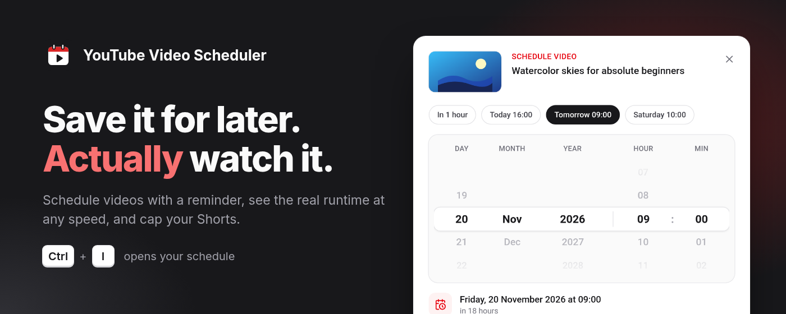
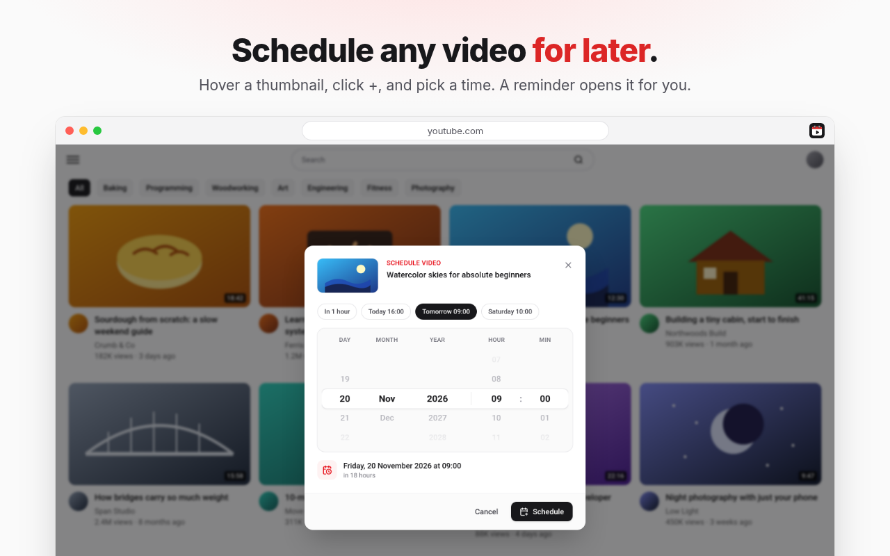
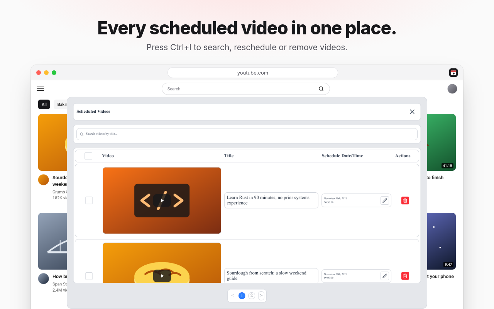
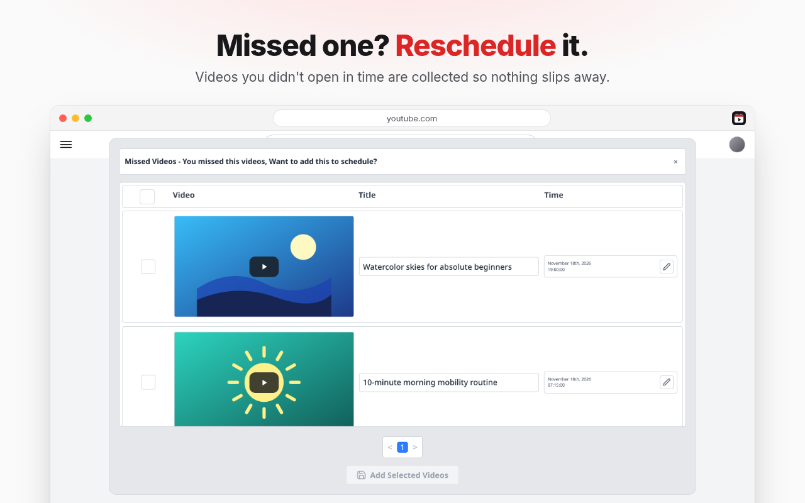
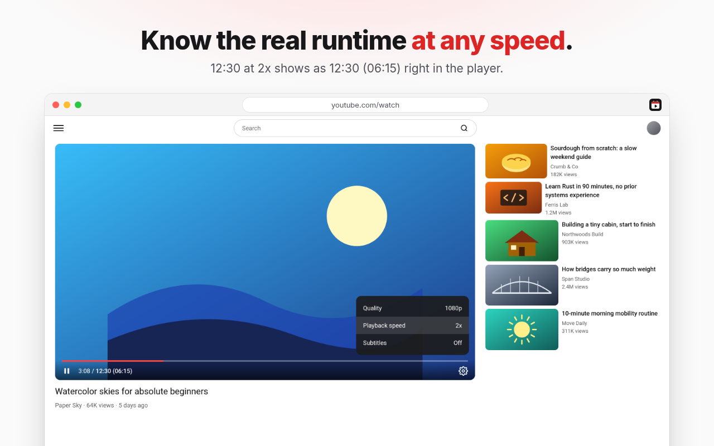
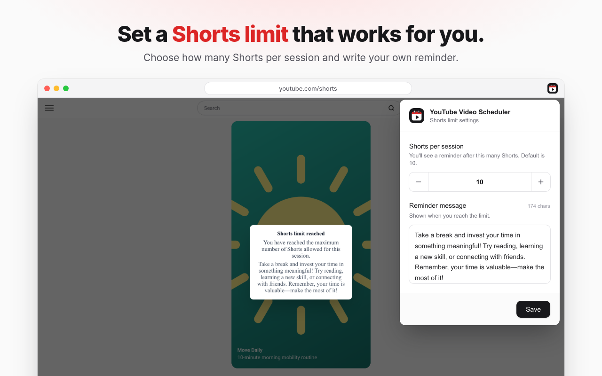
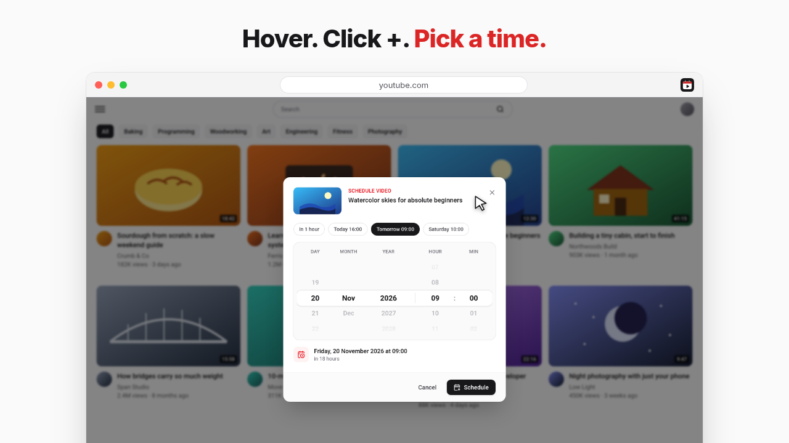

<div align="center">


# YouTube Video Scheduler

**Save it for later. Actually watch it.**

Schedule YouTube videos with a reminder that opens them on time, see the real runtime at any playback speed, and set a limit on Shorts.

[](https://chromewebstore.google.com/detail/youtube-video-scheduler/miponnamafdenpgjemkknimgjfibicdc)
[](https://addons.mozilla.org/en-US/firefox/addon/youtube-video-scheduler/)


[Website](https://youtube-video-scheduler.gliches.workers.dev) · [Add to Chrome](https://chromewebstore.google.com/detail/youtube-video-scheduler/miponnamafdenpgjemkknimgjfibicdc) · [Add to Firefox](https://addons.mozilla.org/en-US/firefox/addon/youtube-video-scheduler/)

<a href="https://youtube-video-scheduler.gliches.workers.dev"></a>

</div>

## Features

- **Schedule from any thumbnail.** Hover a video and click **+** to open the scheduler. Pick a preset (in 1 hour, later today, tomorrow 09:00, the weekend) or set the exact date and time.
- **A reminder that opens the video.** When it's due, you get a notification and the video opens in a new tab.
- **Dashboard.** Press <kbd>Ctrl</kbd>+<kbd>I</kbd> (<kbd>⌘</kbd>+<kbd>I</kbd> on Mac) to search, reschedule or remove scheduled videos, one at a time or in bulk.
- **Missed videos.** If a reminder fires while the browser is closed, the video appears in a missed-videos table the next time you open YouTube, so you can reschedule it.
- **Real runtime at any speed.** At 2x, a 12:30 video shows as `12:30 (06:15)` in the player.
- **Shorts limit.** Set how many Shorts you watch per session and write your own reminder message, from the extension popup.

## Screenshots

| | |
| --- | --- |
|  |  |
|  |  |
|  | [](store-assets/video/youtube-video-scheduler-demo.mp4) |

The last tile links to the 10-second demo video ([`store-assets/video/youtube-video-scheduler-demo.mp4`](store-assets/video/youtube-video-scheduler-demo.mp4)).

## How to use

1. Install from the [Chrome Web Store](https://chromewebstore.google.com/detail/youtube-video-scheduler/miponnamafdenpgjemkknimgjfibicdc) or [Firefox Add-ons](https://addons.mozilla.org/en-US/firefox/addon/youtube-video-scheduler/).
2. On YouTube, hover any video thumbnail and click the **+** button.
3. Pick when you want to watch it and click **Schedule**.
4. Press <kbd>Ctrl</kbd>+<kbd>I</kbd> to open your schedule. Missed videos appear on their own when you next open YouTube.
5. Click the extension icon to set your Shorts limit and reminder message.

### Keyboard shortcuts

| Shortcut | Action |
| --- | --- |
| <kbd>Ctrl</kbd>+<kbd>I</kbd> (<kbd>⌘</kbd>+<kbd>I</kbd> on Mac) | Toggle the scheduled videos dashboard |
| <kbd>Esc</kbd> | Close the schedule dialog |

You can change the dashboard shortcut at `chrome://extensions/shortcuts` (Chrome) or under **Manage Extension Shortcuts** in `about:addons` (Firefox).

## Privacy

Your schedule and settings stay in your browser's extension storage. There's no account, no analytics and no server. The extension only runs on `youtube.com`. See the [privacy policy](https://youtube-video-scheduler.gliches.workers.dev/privacy).

## Development

Built with [WXT](https://wxt.dev/), React 19 and Tailwind CSS 4.

```bash
bun install
bun run dev            # Chrome, with hot reload
bun run dev:firefox    # Firefox
bun run build          # production build in .output/
bun run zip            # store packages (zip:firefox for Firefox)
```

### Project layout

| Path | What's there |
| --- | --- |
| `src/entrypoints/` | Background worker, content scripts (scheduler, runtime, Shorts) and the popup |
| `src/components/` | React UI: schedule dialog, date picker, dashboard, missed-videos table, Shorts settings |
| `public/icon/` | Extension icons, generated from `store-assets/brand/logo.svg` |
| `store-assets/` | Store screenshots, promo tiles, demo video and the scripts that make them ([details](store-assets/README.md)) |
| `site/` | Landing page, deployed to Cloudflare |

### Store assets and website

Screenshots, promo tiles and the demo video are generated from the real extension UI with Playwright:

```bash
bun run assets:icons   # logo.svg -> extension, store and site icons
bun run assets         # build, capture UI, compose screenshots and promos, render video
bun run site:deploy    # deploy site/ to Cloudflare
```

## Contributing

Contributions are welcome:

1. Fork the repository.
2. Create a branch for your feature or fix.
3. Open a pull request with a clear description of the change.

For larger changes, please open an issue first to discuss what you'd like to change.

## License

[MIT](LICENSE)

<sub>An independent extension, not affiliated with or endorsed by YouTube or Google.</sub>
